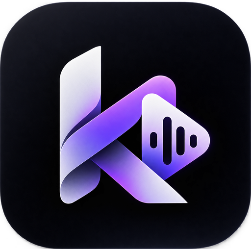

<div align="center">
    
    <h1>K4 Audio</h1>
    <p><b>Your music. Every screen.</b><br/>A free, ad-free music player for Android and Windows by Kartik Langwan</p>

<a href="https://k4music.vercel.app/download"></a>
<a href="https://k4music.vercel.app/download/windows"></a>
<a href="https://github.com/KartikLangwan/K4Audio/releases"></a>

<p>


</p>

<p><a href="https://k4music.vercel.app">k4music.vercel.app</a> · <a href="https://www.instagram.com/K4RTIK.nvm/">Instagram: K4RTIK.nvm</a> · <a href="https://kartiklangwan.vercel.app">kartiklangwan.vercel.app</a></p>
</div>

---

## Download

Downloads are in this repository's [**Releases**](https://github.com/KartikLangwan/K4Audio/releases) and on [k4music.vercel.app](https://k4music.vercel.app).

| | Android | Windows |
| --- | --- | --- |
| **File** | [K4Audio-v2.14.26-RELEASE.apk](https://github.com/KartikLangwan/K4Audio/releases/download/v2.14.26/K4Audio-v2.14.26-RELEASE.apk) | [K4Audio-Setup-2.14.26.exe](https://github.com/KartikLangwan/K4Audio/releases/download/v2.14.26/K4Audio-Setup-2.14.26.exe) |
| **Requires** | Android 7.0+, 64-bit ARM (arm64-v8a) | Windows 10 / 11, 64-bit |
| **Size** | 26.8 MB | 116.2 MB |
| **SHA-256** | `52EC648D3A8F788F7F96221DDF3F28E042CF6C06D932C1E824BD7B264A797557` | `79AAA0E615505EE380FC35BA25CAB4AEB721175ACF12980E09C59CC4B332AE89` |

2.14.26 installs over 2.12.14 and keeps your library, likes, downloads and history. Libraries backed up from 2.14.26 need 2.14.26 or newer to restore.

**Android:** open the APK on your phone and allow *Install unknown apps* for your browser when Android asks. Updating from a build signed with a different key? Uninstall that build first.

**Windows:** run the installer (no admin rights needed). It isn't code-signed yet, so on *Windows protected your PC* click **More info → Run anyway**. Later updates: Settings → Check for updates → **Update now**, or run a newer installer; it closes K4 Audio, updates it and keeps your library.

## What's new in 2.14.26

- **K4 Audio:** the app was called K4 Music. New name, new logo and a black-and-white minimal theme on phone and PC. Installing over the old app keeps your library, likes, playlists and downloads; on PC your old `K4 Music` data folder is moved to `K4 Audio` on first start.
- **A music folder you can see:** `Music\K4 Audio` on the PC is created automatically; on the phone it is `Music › K4 Audio`. Songs you drop in appear under *Library → Local*, and an **Open music folder** button is in the Local tab (and PC Settings).
- **Time-aware greeting:** Home now says Good morning / afternoon / evening / night (it said "Good evening" in the middle of the night).
- **Phone → PC transfer sends every playlist** (YouTube and Spotify imports too), not only liked songs.
- **Downloads:** fewer parallel downloads on the phone, and the PC retries YouTube with other clients when it asks if you are a bot (plus an optional browser sign-in in Settings → Player).

- **Lighter:** the Android app is a quarter smaller (28 MB) and uses far less memory for artwork; the PC app hands unused memory back to Windows while it plays in the background, and redraws much less while a song plays.
- **More reliable:** safer library backup and restore, downloads that can be cancelled and retried, saved lyrics and play counts that are never lost, and playback that resumes near where it stopped even after a crash.
- **Better sound on Android:** JioSaavn and local songs no longer play much louder than YouTube songs with loudness normalization on.
- **A tidier player on PC:** balanced controls, and like, lyrics, queue, sound output and volume right inside the full-screen player.
- **Polished screens:** clearer buttons and options in Settings, keyboard shortcuts shown as keys, helpful empty Favorites / History / Downloads pages, and a layout that fits small windows.
- **Private by default:** the Discord status is now off until you turn it on.
- **Mini player stays put (Android):** it can no longer be swiped away by accident.
- **The right lyrics:** synced lyrics now match the song that is playing instead of falling back to another song's words.
- **PC fixes:** a second launch brings the window back, Add to playlist → New playlist works, Esc closes menus first, the search box takes typing straight away, and yt-dlp keeps itself up to date every week.
- **Phone → PC transfer:** the PC shows a QR code (Settings → Phone transfer), the phone scans it (Settings → Backup & restore → Send library to PC) and your likes and playlists go straight to the PC over your Wi-Fi, encrypted, with no server in between.

Every fix and how it was verified: [AUDIT.md](docs/AUDIT.md) and [AUDIT-2026-10-24.md](docs/AUDIT-2026-10-24.md).

## Bring your music across

- **PC:** copy songs into `Music\K4 Audio` (or add any folder in Settings), then press *Scan*.
- **Phone from PC:** plug the phone in with USB, choose *File transfer*, copy the audio files into `Music/K4 Audio` on the phone. They show up in *Library → Local* by themselves.
- **Likes and playlists, phone → PC:** PC *Settings → Phone transfer* shows a QR code; scan it in the phone app (*Settings → Backup & restore → Send library to PC*).

## Features

- 🎵 **Two catalogues, one player:** YouTube Music first, JioSaavn as a second source and automatic fallback
- ⬇️ **Downloads** for offline listening, with streaming quality from *Data saver* to *High*
- 📥 **Playlist import** from Spotify and YouTube Music links
- 🎚️ **Real audio effects:** equalizer with presets and manual bands, bass boost, 3D/surround, wide stage, reverb, loudness normalization
- 🔁 Consistent repeat and shuffle, queue-safe *Play next*, persistent queue
- 🔍 Search songs, albums, artists, videos and playlists; discover by mood and genre
- 🎤 Lyrics, including synchronized lyrics
- 📱 Local music from your device, background playback, Android Auto
- 🎨 Dynamic theme and Material You colours, dark purple design
- 🔗 Opens YouTube / YouTube Music links (`watch`, `playlist`, `channel`, …)
- 🚫 No ads, no account needed, lightweight

### On Windows

- 🎧 Pick the audio output (Bluetooth, headphones, speakers), even mid-song
- ⌨️ Media keys and Bluetooth headphone buttons work in the background; Previous / Play-Pause / Next under the taskbar thumbnail
- 💬 Discord status: *Playing K4 Audio* with the song and cover, and an icon next to your name in voice channels
- 🪟 Resizable, hideable panels, navigation left or bottom, full screen (F11), system tray
- 🔄 In-app updates from this repository's releases

## Build from source

Needs JDK 21+ and the Android SDK.

```
gradlew :app:assembleRelease
```

Windows app (Compose Desktop). Put the native tools in `windows/downloads/` first: `mpv/libmpv-2.dll`, `yt-dlp_win.zip`, `qjs-windows-x86_64.exe` and a portable Inno Setup in `innosetup/`. Then:

```
gradlew -p windows packageInstaller
```

The installer lands in `windows/build/installer/`.

The APK lands in `app/build/outputs/apk/release/`. Production release/nightly builds require a private signing keystore. Configure `ANDROID_NIGHTLY_KEYSTORE`, `ANDROID_NIGHTLY_KEYSTORE_ALIAS` and `ANDROID_NIGHTLY_KEYSTORE_PASSWORD` (the existing CI variable names also configure release signing). For local testing, build `:app:assembleDebug`; an intentionally debug-signed release requires `-PallowDevelopmentSigning=true` and must not be distributed as a production release.

For the repeatable verification workflow, run `scripts/verify-release.ps1` with `-PythonCommand` pointing to a Python 3 interpreter and, if needed, `-GradleCommand` pointing to Gradle 9.8.0. Use `-Offline` when dependencies are already cached. The script runs regression tests and lint, builds the release, checks its signature and packaged runtimes, and exports the APK with a SHA256 checksum.

After compiling both platforms, run `python -B scripts/verify-library-parity.py` to check their shared DAO queries, generated table/index/view SQL and Room identity against the committed Android schema. This check reads generated files; run it after fresh platform builds.

## Origin

K4 Audio is a merge of two codebases: [ViTune](https://github.com/25huizengek1/ViTune)
(base: player, providers, UI) and K4 Audio (JioSaavn catalogue, taste engine,
crash-safe downloads, K4 theme). Upstream licenses and attributions are kept
in `LICENSE` and Acknowledgments below.

## Acknowledgments

- [**YouTube-Internal-Clients**](https://github.com/zerodytrash/YouTube-Internal-Clients): A Python
  script that discovers hidden YouTube API clients. Just a research project.
- [**ionicons**](https://github.com/ionic-team/ionicons): Premium hand-crafted icons built by Ionic,
  for Ionic apps and web apps everywhere.
- [**Flaticon: Ilham Fitrotul Hayat**](https://www.flaticon.com/authors/ilham-fitrotul-hayat): the
  app's logo uses a music note icon.

## Disclaimer

This project and its contents are not affiliated with, funded, authorized, endorsed by, or in any
way associated with YouTube, Google LLC or any of its affiliates and subsidiaries.

Any trademark, service mark, trade name, or other intellectual property rights used in this project
are owned by the respective owners.
